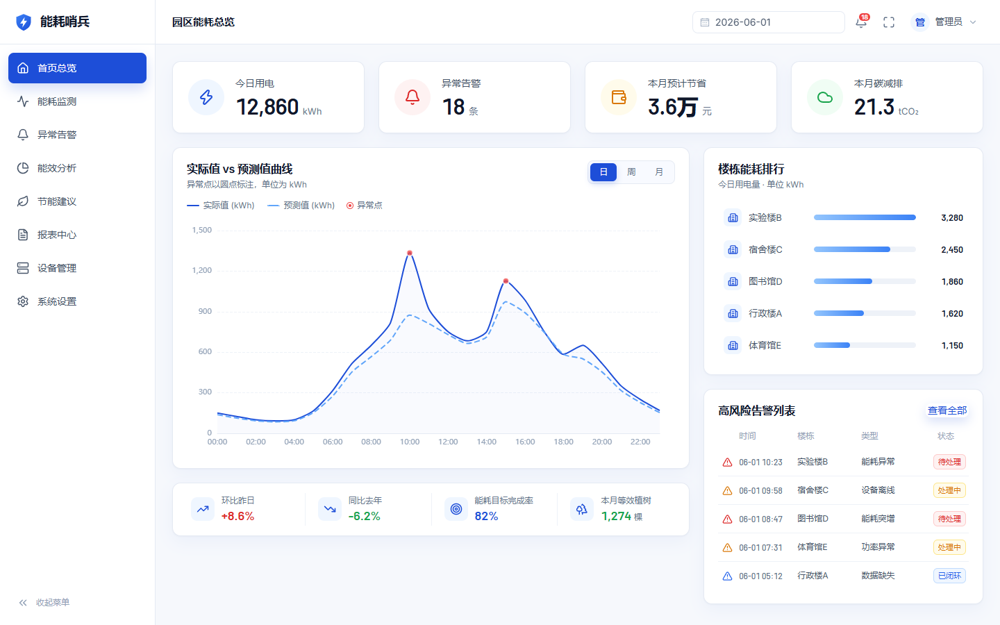

# 能耗哨兵前端（Energy Sentinel Web）

园区/校园能耗异常诊断与节能优化平台的前端。按申报书中的蓝白管理后台风格实现，包含首页总览、告警中心、能耗监测、能效分析、节能建议、报表中心、设备管理、系统设置，以及深色可视化大屏。



## 技术栈

- Vue 3.5 + TypeScript + Vite 6
- Vue Router 4 + Pinia
- Element Plus（深度主题覆盖）
- ECharts（按图表类型注册）
- axios + dayjs + @vueuse/core
- MSW 2（开发期 Mock）
- Vitest / Playwright（后续补齐）
- ESLint + Prettier + vue-tsc

## 快速开始

```bash
cd energy-sentinel-web
npm install
npm run dev
```

打开 http://localhost:5173。

> 首次克隆时如果 `public/mockServiceWorker.js` 不存在，执行 `npm run mock:init` 重新生成。

### 演示账号

| 角色 | 用户名 | 密码 | 说明 |
|---|---|---|---|
| 管理员 | `admin` | `admin123` | 全部功能 |
| 后勤 | `logistics` | `logistics123` | 告警处理/派单、建议采纳、报表生成 |
| 运维 | `ops` | `ops123` | 告警处理、设备编辑 |
| 观察员 | `observer` | `observer123` | 只读，无系统设置 |

登录页的“演示账号”区域可一键填充。

## 常用命令

| 命令 | 说明 |
|---|---|
| `npm run dev` | 启动开发服务器 |
| `npm run build` | 类型检查 + 生产构建 |
| `npm run preview` | 预览构建产物 |
| `npm run typecheck` | `vue-tsc` 类型检查 |
| `npm run lint` | ESLint |
| `npm run format` | Prettier |
| `npm run test` | Vitest（当前无测试时通过） |
| `npm run mock:init` | 生成 MSW service worker |
| `npm run check:api` | 检查后端 OpenAPI 是否覆盖约定端点 |
| `npm run log:new` | 生成当日开发日志骨架 |

## Mock 与真实后端

开发环境默认使用 MSW，页面不依赖后端即可完整演示。

切换真实后端时，复制 `.env.example` 为 `.env.local`（不要提交），按需修改：

```bash
VITE_USE_MOCK=false
VITE_API_BASE_URL=http://localhost:8000/api/v1
```

- 后端接口约定见 [docs/api-contract.md](docs/api-contract.md)。
- 后端建议使用 FastAPI，开发环境 CORS 放行 `http://localhost:5173`。
- 后端就绪后运行 `npm run check:api`；默认检查 `http://localhost:8000/openapi.json`。
- 页面只依赖 `src/api/modules`，切换环境变量不需要改页面。

## 目录结构

```text
src/
├─ api/            # axios 实例、session、DTO、业务 API
├─ assets/         # Logo 与静态资源
├─ components/     # base 基础组件、charts 图表、business 业务组件
├─ composables/    # 组合式函数（后续补 useRequest/usePolling）
├─ config/         # env、constants、permissions、status
├─ layouts/        # AdminLayout、AppHeader、AppSidebar
├─ mocks/          # MSW browser、handlers、fixtures、共享 db
├─ router/         # 路由、守卫、RouteMeta 类型
├─ stores/         # auth、app、dashboard
├─ styles/         # tokens、base、Element Plus 覆盖
├─ utils/          # storage、format
├─ views/          # 登录、首页、告警、大屏、UI Kit、占位页、错误页
├─ App.vue
└─ main.ts
```

## 文档

- [API 契约](docs/api-contract.md)
- [开发日志规范](docs/dev-log/README.md)
- [开发日志时间线](docs/dev-log/index.md)
- [2026-11-18 开发日志](docs/dev-log/2026-11-18.md)
- [变更记录](CHANGELOG.md)

## 当前进度

- ✅ M0 工程基线
- ✅ M1 应用壳与登录
- 🟡 M2 首页总览首版（1440/1920 截图已验证，待周/月切换回归）
- ⬜ M3–M8 按里程碑实施

## 注意事项

- 仓库只提交 `.env.example` 和公开的 `VITE_*` 配置；不要放密钥、token、证书。
- 演示数据全部为虚构楼栋与固定种子，不含学校真实数据。
- 当前 Element Plus 与 ECharts 为完整引入，构建有 chunk > 500 kB 警告；M8 统一做按需引入和分包。
- 不自动执行 `git commit` / `git push`；推送前需要确认远程地址并展示变更摘要。
