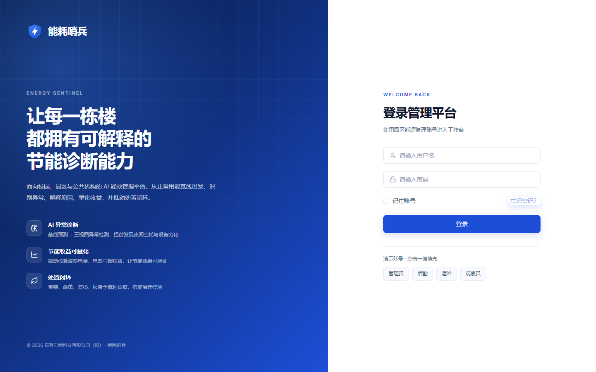
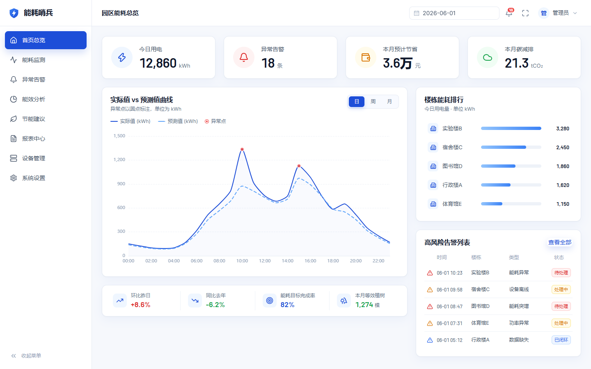
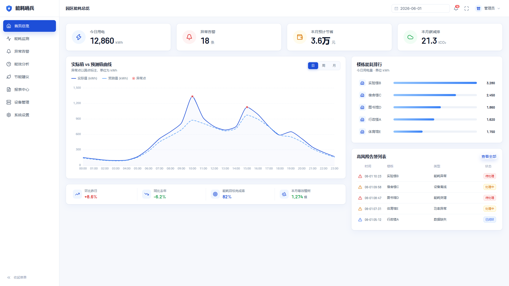
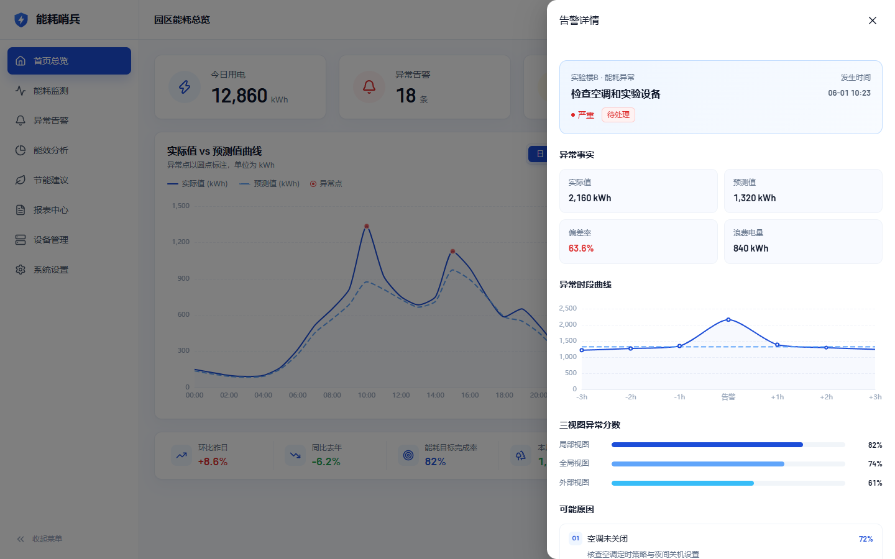
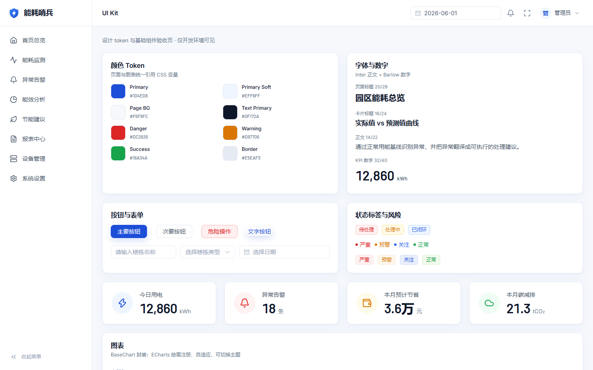
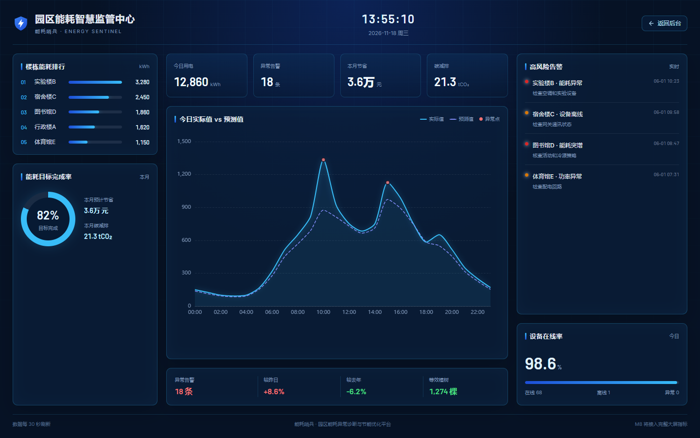
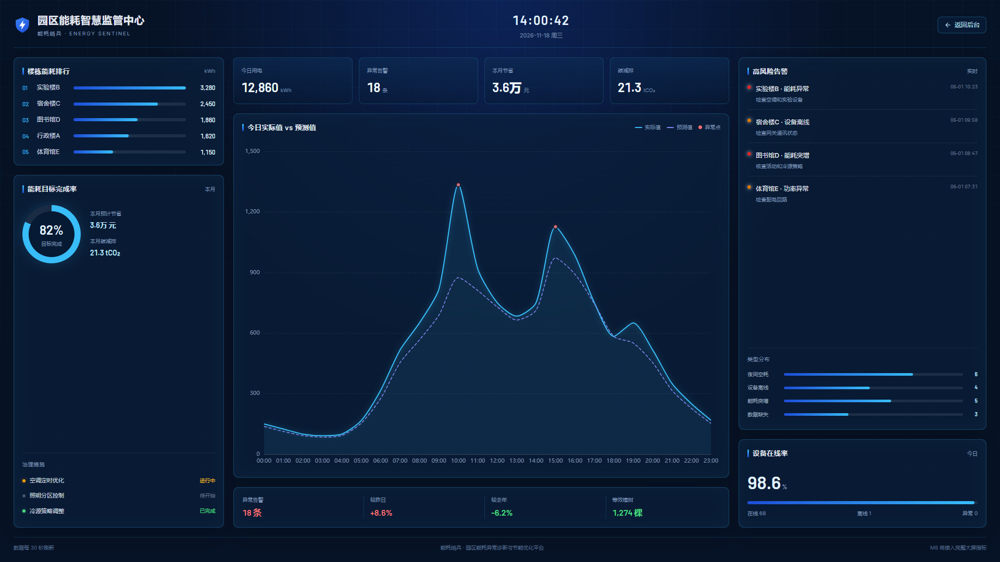
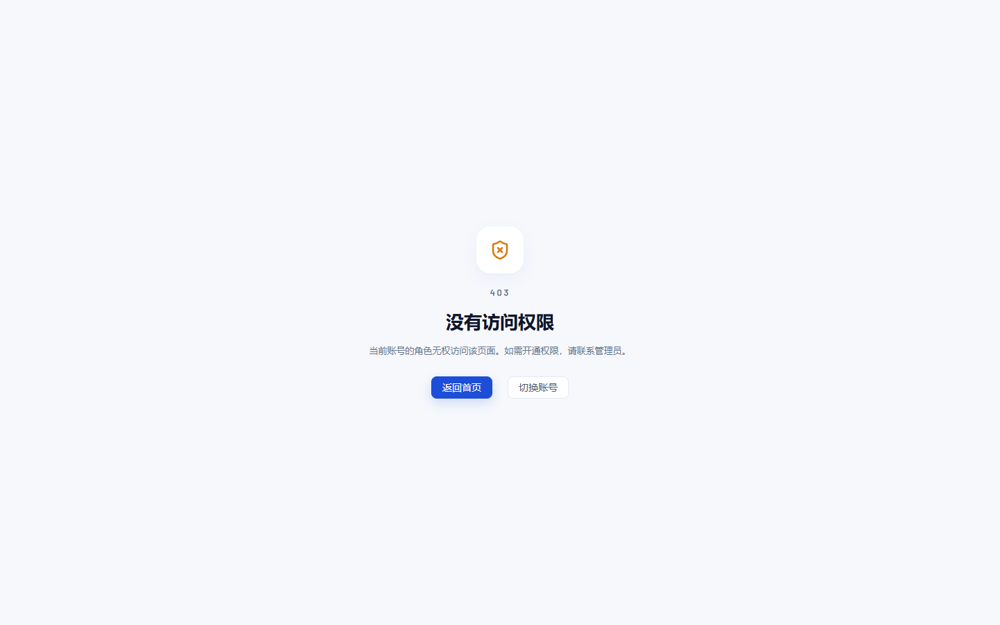

# 2026-11-18 开发日志

- 所属阶段：M0 工程基线、M1 应用壳与登录、M2 首页总览首版
- 参与人：Claude Code + 项目组
- 耗时：约 1 个开发日

## 今日目标

- [x] 从零搭建 Vue 3 + TypeScript + Vite 工程
- [x] 落地蓝白设计 token 与 Element Plus 主题覆盖
- [x] 完成登录页、后台布局、路由守卫与四角色权限
- [x] 完成首页总览首版（KPI、曲线、排行、告警、底部指标）
- [x] 完成深色大屏预览与 UI Kit 验收页
- [x] 建立 API 契约、开发日志与 Git 规范

## 完成内容

### 工程底座

- 使用 Vite 6 + Vue 3.5 + TypeScript，启用 `strict`、路径别名 `@`。
- 接入 Vue Router、Pinia、Element Plus、ECharts、axios、dayjs、@vueuse/core。
- 接入 MSW 2，开发环境默认拦截 `/api/v1`，无需后端即可演示。
- 配置 ESLint flat config、Prettier、`vue-tsc` 类型检查。
- 生成 `public/mockServiceWorker.js`，并写入 `package.json` 的 `msw.workerDirectory`。

### 设计系统

- `src/styles/tokens.scss`：主色 `#1D4ED8`、页面底色 `#F6F8FC`、卡片边框 `#E5EAF3`、状态色、侧边栏 224px、顶栏 64px、字体与阴影。
- `src/styles/element/overrides.scss`：覆盖 Element Plus 主色、圆角、输入框、表格、标签、抽屉、弹窗。
- 字体：Inter 正文 + Barlow 数字，开启 tabular-nums；中文走系统字体。
- 自绘盾牌闪电 Logo，未使用线框图中的位图。

### 布局与权限

- `AdminLayout`：顶栏 + 侧边栏 + 内容区，侧边栏可收起并持久化。
- `AppHeader`：Logo、页面标题、日期选择、告警通知、全屏、头像下拉。
- 路由守卫：登录校验、`/auth/me` 补全、角色不匹配跳 403、开发页仅 DEV 可见。
- 四个演示角色：管理员、后勤、运维、观察员；系统设置仅管理员可见。
- 登录页：品牌蓝左栏、表单校验、记住账号、演示账号一键填充、站内 redirect 校验。

### 首页总览

- 4 张 KPI 卡：今日用电、异常告警、本月预计节省、本月碳减排。
- 实际值 vs 预测值曲线：ECharts 折线 + 虚线 + 异常点散点，日/周/月切换。
- 楼栋能耗排行：进度条列表，点击跳楼栋详情。
- 高风险告警列表：风险/状态颜色、点击打开详情抽屉。
- 告警详情抽屉：异常事实、时段曲线、三视图分数、原因排序、损失核算、处置时间线、状态流转。
- 底部四指标：环比、同比、目标完成率、等效植树。
- 60 秒轮询，页面不可见时暂停；错误态可重试。

### Mock 数据

- 固定种子生成 6 栋楼、30 天小时曲线、异常点、18 条告警和首页 KPI。
- 首页用电 12,860 kWh、月度节省 36,200 元、碳减排 21.3 tCO₂、等效植树 1,274 棵，全部由同一套公式计算。
- 电价 0.8 元/kWh、排放因子 0.47 kgCO2/kWh 集中在 `src/config/constants.ts`。
- Mock token 采用无状态格式 `mock-access.<username>.<timestamp>`，刷新页面后登录态不丢失。
- 告警状态在 `src/mocks/db/alarms.ts` 共享，抽屉改状态后首页列表同步更新。

### 深色大屏与 UI Kit

- `/screen`：深色预览，含楼栋排行、目标完成率环、KPI、发光曲线、高风险告警、告警类型分布、治理措施、设备在线率；1920×1080 下无滚动、无溢出。
- `/dev/ui-kit`：颜色、字体、按钮、表单、标签、KPI 卡、图表、表格集中验收（仅开发环境）。

### 文档与交付

- `docs/api-contract.md`：认证、首页、楼栋、能耗、能效、告警、建议、报表、设备、设置、错误码与后端交付清单。
- `scripts/check-api-contract.mjs` + `scripts/contract.json`：后端就绪后检查 OpenAPI 端点是否齐全。
- `scripts/new-dev-log.mjs`：生成每日开发日志骨架。
- `.env.example`：只包含公开 `VITE_*` 变量，不含密钥。
- `CHANGELOG.md`、`README.md`、本日志。

## 关键文件

- `src/styles/tokens.scss`、`src/styles/element/overrides.scss`
- `src/layouts/AdminLayout.vue`、`src/layouts/components/AppHeader.vue`、`AppSidebar.vue`
- `src/views/login/LoginView.vue`
- `src/views/dashboard/DashboardView.vue`
- `src/views/screen/ScreenView.vue`
- `src/views/dev/UiKitView.vue`
- `src/components/charts/BaseChart.vue`、`src/components/business/AlarmDetailDrawer.vue`
- `src/mocks/fixtures/dashboard.ts`、`src/mocks/db/alarms.ts`
- `src/router/routes.ts`、`src/router/guards.ts`
- `docs/api-contract.md`、`scripts/check-api-contract.mjs`

## 截图 / 演示

- 登录页：
- 首页总览：
- 首页 1920 适配：
- 告警详情抽屉：
- UI Kit：
- 深色大屏 1440 预览：
- 深色大屏 1920 预览：
- 403 权限页：

## 问题与解决

1. **npm 11 prefix 报错**
   - 现象：在用户主目录执行 `npm -v` 报 “config prefix cannot be changed from project config”。
   - 原因：`~/.npmrc` 中的 `prefix=D:\NodeJs\node_global` 被 npm 11 当作 project config。
   - 处理：在项目目录内执行 npm 正常，未修改全局 `.npmrc`；后续安装统一在项目目录执行。

2. **Element Plus / ECharts 包体偏大**
   - 现象：构建后 Element Plus 约 947 kB、ECharts 约 581 kB（未 gzip）。
   - 处理：M0 优先保证组件齐全和运行稳定，采用完整引入；M8 再做按需引入和 chunk 优化。

3. **登录页标题孤字**
   - 现象：品牌标题第二行末尾单独出现“力”。
   - 处理：改为三行显式换行，保持视觉平衡。

4. **线框图中的数字口径不一致**
   - 现象：`3.6 万元` 与 `2.1 tCO₂` 按电价/排放因子无法同时成立。
   - 处理：统一为月度 36,200 元 / 21.3 tCO₂，等效植树 1,274 棵，全部由公式计算。

5. **Mock token 刷新页面丢失登录态**
   - 处理：token 写入用户名与时间戳，`/auth/me` 与 `/auth/refresh` 从 token 解析用户，不再依赖内存 session。

## 明日计划

- [x] M2 首版：1920×1080 截图对比、无横向溢出
- [ ] M2 收尾：日期/周月切换回归、1280 窄屏检查
- [ ] M3 异常告警中心：筛选、分页、表格、详情抽屉、派单、URL 同步
- [ ] 补充告警中心 18 条种子数据与汇总芯片

## 验证记录

- `npm run typecheck`：通过
- `npm run build`：通过（仅有 chunk > 500 kB 警告）
- `npm run lint`：0 error
- Playwright（Edge headless）：
  - 登录 `admin/admin123` → `/dashboard` 成功
  - 首页渲染 4 张 KPI 卡、1 个 ECharts canvas，页面包含 `12,860`
  - 点击第一条告警打开抽屉，包含“异常事实”“三视图异常分数”
  - 点击“接单处理”后出现“闭环归档”
  - 管理员可访问 `/settings`；观察员侧边栏无“系统设置”，直输 URL 跳 `/403`
  - 控制台错误：0
  - 1920×1080：首页 `scrollWidth = 1920`，内容区 `clientWidth = scrollWidth`；大屏 `scrollWidth = 1920 / scrollHeight = 1080`，无滚动条
